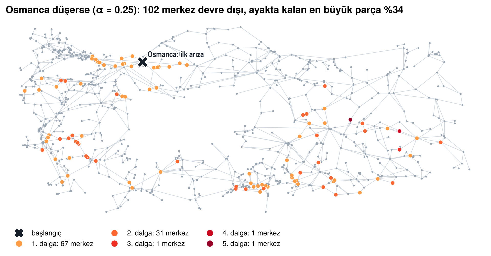

# Türkiye Elektrik İletim Altyapısı: Tek Hata Noktaları ve Kaskad Arıza

> **Bulgunun tek cümlelik özeti:** Türkiye iletim şebekesi radyal uçlarda bölünür (326 eklem noktasının 14'ü 10+ trafo merkezini koparır), ama ülke geneline yayılan zincirleme arıza Marmara'yı Anadolu'ya bağlayan Osmanca–Kurşunlu–Kayabaşı 380 kV koridorundan başlar: bu koridordaki yüklü bir merkezin kaybı, yük yeniden dağıtım modelinde şebekenin ayakta kalan en büyük parçasını ortalama %32'ye indirir (rastgele bir merkezde %97).

> **CV cümlesi:** OpenStreetMap'ten 1.193 trafo merkezli Türkiye iletim ağını kurup eklem noktası analizi ve Motter–Lai yük yeniden dağıtım modeliyle kaskad arıza simülasyonu yaptım; tarayıcıda çalışan etkileşimli bir kırılganlık haritası yayımladım (Python, NetworkX, Cytoscape.js).



| | |
|---|---|
| **Etkileşimli ağ (TR/EN)** | `docs/interaktif/index.html` → GitHub Pages: `https://saidozen.github.io/turkiye-elektrik-iletim-agi/interaktif/` |
| **Rapor (PDF, 8 sayfa)** | [docs/rapor.pdf](docs/rapor.pdf) |
| **A3 ağ posteri** | [docs/poster.pdf](docs/poster.pdf) |
| **Sunum (10 slayt)** | [docs/sunum.pdf](docs/sunum.pdf) |
| **Jupyter defteri** | [notebooks/analiz.ipynb](notebooks/analiz.ipynb) |
| **Kenar listesi / GraphML** | [data/processed/edges.csv](data/processed/edges.csv), [data/processed/grid.graphml](data/processed/grid.graphml) |
| **Veri sözlüğü** | [docs/veri_sozlugu.md](docs/veri_sozlugu.md) |

Sosyal Ağ Analizi dönem ödevi · Said Özen (2516016014) · Manisa Celal Bayar Üniversitesi, Manisa Teknik Bilimler MYO, Büyük Veri Analistliği · Öğr. Gör. Osman Can Çetlenbik · 2026–2027 Güz

---

## Araştırma sorusu
İletim ağında hangi trafo merkezleri tek hata noktası? Basit bir zincirleme arıza nasıl yayılır?

## Veri ve ağ
- **Kaynak:** OpenStreetMap Overpass API — `power=substation` ve `power=line`, Türkiye (`ISO3166-1=TR`). İndirme: 28.10.2026. **Lisans: ODbL 1.0**, © OpenStreetMap katkıcıları.
- **Düğüm:** trafo merkezi (`minor_distribution` hariç). **Kenar:** iki merkezi birleştiren iletim hattı (≥ 66 kV ya da gerilimi etiketsiz). **Yönsüz** (AC şebekede güç iki yöne akar), **ağırlıksız** (OSM'de hat kapasitesi yok; uzunluk ve gerilim bilgi olarak saklanır).
- Hat uçları trafo alanına (50 m pay) ya da merkezine 300 m yakınına düşüyorsa o merkeze eşlenir; parçalı hatlar ve T-branşmanlar ortak direklerde birleştirilir. Tüm kararlar ve sütunlar: [docs/veri_sozlugu.md](docs/veri_sozlugu.md).
- **Ağ:** 1.193 düğüm, 1.543 kenar, 39 bileşen; en büyük bileşen 1.072 düğüm (%90). 500 düğüm eşiği aşıldığı için örnekleme yapılmadı; tüm ölçüler tam hesaplandı.

## Ana bulgular
| | Sonuç |
|---|---|
| Temel yapı | Yoğunluk 0,0022 · ortalama derece 2,6 · ortalama en kısa yol 12,7, çap 35 · kümelenme 0,204 · derece benzeşimi −0,03 |
| Derece dağılımı | Üstel benzeri; kuvvet yasası (α = 3,8, k ≥ 4) üstel ve log-normale karşı üstün değil (R < 0) |
| Merkeziyet | Betweenness: Osmanca (0,44), Kurşunlu (0,37), Kayabaşı (0,35) — aynı 380 kV koridoru. Derece: Aliağa-2 (15), Adapazarı-2 (14), Seydişehir (13) |
| Topluluklar | Louvain 25 topluluk, Q = 0,890; Leiden 25 topluluk, Q = 0,890; 10 tohumla NMI = 0,90; Louvain–Leiden uyumu NMI = 0,92. Trakya–İstanbul, Doğu Marmara, Konya–Antalya, Orta Anadolu–Karadeniz… |
| Null model (100 + 100) | Kümelenme z = 142, ortalama yol z = 91, modülerlik z = 45 (rastgele ağ Q = 0,72), derece benzeşimi z = −0,9 |
| Tek hata noktaları | 326 eklem noktası (%30), 367 köprü (%25); yalnızca 14 eklem noktası 10+ merkez koparır (Kozan 15, Kozan Havza 14, Balıkesir-2 12, Silivri/Küre/Bursa DGKÇ 11) |
| Kaskad (α = 0,25) | Ayakta kalan en büyük parça G: en yüklü 10 merkez → 0,32 · en kritik 10 eklem noktası → 0,84 · rastgele 20 merkez → 0,97. Osmanca düşerse 5 dalgada 102 merkez devre dışı, G = 0,34 |

## Depo yapısı
```
data/raw/            OSM ham verisi (substations.json, lines.json, meta.json)
data/processed/      nodes.csv, edges.csv, grid.graphml, grid_strict.graphml, build_report.json
results/             analiz.json ve tüm tablolar (merkeziyet, eklem, köprü, kaskad, null model)
figures/             rapor/poster/sunum şekilleri
notebooks/           analiz.ipynb (çıktılarıyla)
docs/                rapor.pdf, poster.pdf, sunum.pdf, veri_sozlugu.md, sunum_notlari.md
docs/interaktif/     etkileşimli ağ (index.html, GitHub Pages)
docs/kaynak/         PDF'lerin HTML kaynakları
src/
  colab_indir.py           veri toplama (gerçek indirmede kullanılan; hatlar 12 karoda)
  veri_topla.py            veri toplama (tek sorgu sürümü; hatlar sorgusu zaman aşımına uğrayabilir)
  hatlari_parcali_indir.py yalnızca hatları 12 karoda indirir
  ag_kur.py                ham veriden ağ kurma
  analiz.py                temel ölçüler, powerlaw, merkeziyet, topluluk, null model, dayanıklılık
  kaskad.py                eklem noktaları, köprüler, Motter–Lai kaskad simülasyonu
  calistir.py              tüm analizi çalıştırır → results/
  sekiller.py              şekiller → figures/
  etkilesimli.py           etkileşimli sayfa → docs/interaktif/index.html
  pdf_uret.py              docs/kaynak/*.html → PDF
  defter_olustur.py, defter_calistir.py   defteri oluşturur ve çalıştırır
```

## Kurulum ve çalıştırma
```bash
python -m venv .venv && source .venv/bin/activate      # Windows: .venv\Scripts\activate
pip install -r requirements.txt

python src/colab_indir.py      # 1) veri (~30 dk; Overpass yoğunsa tekrar çalıştırın, kaldığı yerden devam eder)
python src/ag_kur.py           # 2) ağ (~5 sn)
python src/calistir.py         # 3) analiz (~20 dk; 2 çekirdek)
python src/sekiller.py         # 4) şekiller
python src/etkilesimli.py      # 5) etkileşimli sayfa
playwright install chromium && python src/pdf_uret.py   # 6) PDF'ler (isteğe bağlı)
```
Defter: `PYTHONHASHSEED=0 jupyter notebook notebooks/analiz.ipynb` (Windows PowerShell: `$env:PYTHONHASHSEED=0; jupyter notebook`). Uzun adımlar varsayılan olarak `results/` klasöründen okunur (`TAM_CALISTIR = True` ile yeniden hesaplanır).

**Tekrarlanabilirlik.** Tüm rastgele işlemler tohum 42 ile sabittir (Louvain/Leiden, null model, rastgele başlangıç düğümleri). Ağ dosyası sıralı yazılır ve analiz grafı sıralı kurulur; `calistir.py` kendini `PYTHONHASHSEED=0` ile başlatır, çünkü Python küme sırası Leiden'i etkiler. Kaskad simülasyonu örneklemesiz (tam) betweenness kullanır, yani deterministiktir; tarayıcıdaki simülasyon Python sonuçlarıyla birebir aynıdır (Osmanca, α = 0,25: dalgalar 1-67-31-1-1-1, G = 0,338).

## GitHub Pages (etkileşimli ağ)
Depo ayarlarında **Settings → Pages → Source: Deploy from a branch → main / docs** seçin. Sayfa `https://saidozen.github.io/turkiye-elektrik-iletim-agi/interaktif/` adresinde yayımlanır. Portfolyoya gömmek için:
```html
<iframe src="https://saidozen.github.io/turkiye-elektrik-iletim-agi/interaktif/" width="100%" height="720" style="border:0" title="Türkiye iletim şebekesi"></iframe>
```

## Sınırlar
- **OSM eksikliği:** hatların %26'sı gerilim etiketsiz; 438 hat kümesi hiçbir trafo merkezine değmiyor; 1.719 hat ucu boşta; 38 küçük bileşen büyük olasılıkla gerçekte bağlı. Eksik bir hat, gerçekte halka olan yapıyı ağaç gibi gösterir; eklem noktası sayısı abartılmış olabilir.
- **Model:** Motter–Lai en kısa yol yükü gerçek AC güç akışı değildir; üretim/tüketim, hat kapasitesi ve koruma sistemleri yoktur. Sonuçlar merkezleri sıralamak içindir, kesinti tahmini değildir. Bulgular nedensellik iddiası taşımaz.
- **İl ataması** en yakın il merkezine göredir (ör. Kozan, Adana'ya bağlı ama Osmaniye merkezine daha yakın).

## Yapay zekâ kullanım beyanı
Bu projede yapay zekâ asistanı **Claude (Anthropic)** kullanılmıştır: veri toplama ve ağ kurma betiklerinin yazımı, analiz ve kaskad kodunun geliştirilmesi, şekillerin, etkileşimli sayfanın, rapor, poster ve sunum taslaklarının hazırlanması. Veri Colab üzerinde tarafımca indirilmiştir. Araştırma sorusu ödev kartından gelir; sonuçlar ve yorumlar tarafımca kontrol edilmiş, sunumda açıklanabilecek şekilde çalışılmıştır (`docs/sunum_notlari.md`).

## Lisans
Kod: [MIT](LICENSE). Veri (`data/`, `results/`): © OpenStreetMap katkıcıları, [ODbL 1.0](https://opendatacommons.org/licenses/odbl/1-0/). Rapor, poster ve sunum: CC BY 4.0.

## Kaynaklar
Motter & Lai (2002), *Phys. Rev. E* 66, 065102 · Albert, Albert & Nakarado (2004), *Phys. Rev. E* 69, 025103 · Solé vd. (2008), *Phys. Rev. E* 77, 026102 · Blondel vd. (2008), *J. Stat. Mech.* P10008 · Traag, Waltman & van Eck (2019), *Sci. Rep.* 9, 5233 · Alstott vd. (2014), *PLoS ONE* 9, e85777 · Hopcroft & Tarjan (1973), *Commun. ACM* 16(6).
